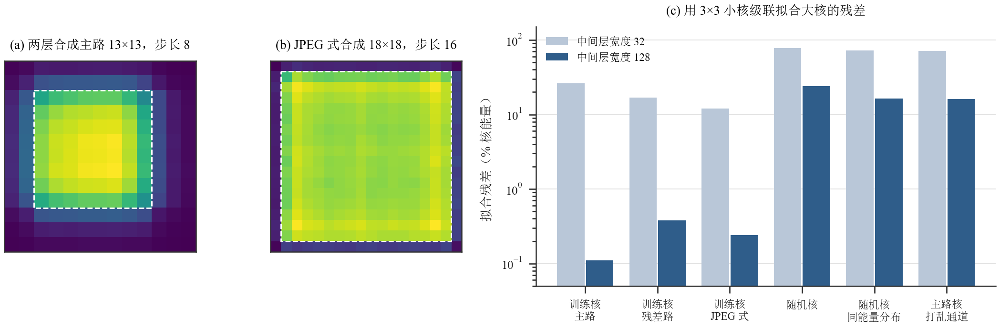
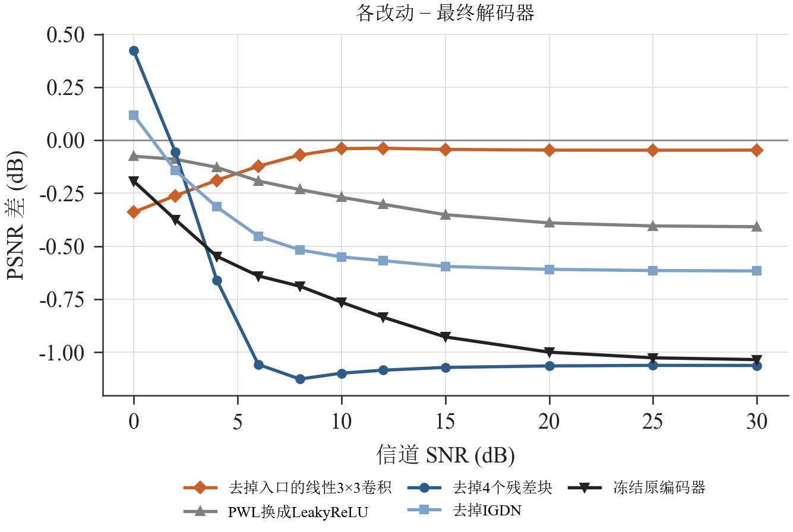
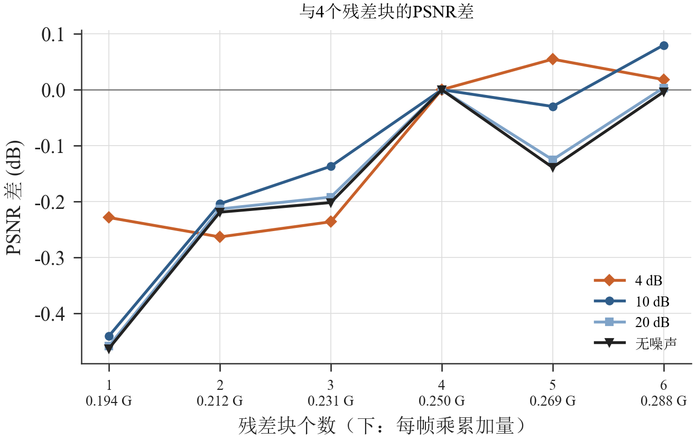

# 浅层解码器

本节描述替代原解码器的浅层解码器：结构、各部分的作用及依据、量化与硬件实现。编码器结构不变，与浅层解码器联合训练；解码器每帧乘累加量从1.443 GMAC降到0.250 GMAC，参数量从245,704降到53,332，W8A12整数模型与原解码器整数模型的PSNR差在0.15 dB以内。

## 1. 结构

图1　浅层解码器结构。框下数字为每帧乘累加量。

表1　各部分的分辨率与计算量

| 分辨率 | 模块 | 每帧乘累加量 |
|---|---|---|
| 64×64×16 | 线性3×3卷积（16→16，无激活） | 9.4 M |
| 64×64×16 | 4个残差块：3×3卷积 → PWL → 3×3卷积 → PWL，加恒等支路 | 75.5 M |
| 64×64 → 128×128 | 亚像素3×3卷积（16→192，主路与旁路各96通道）+ PixelShuffle；主路接IGDN，旁路线性，两路相加 | 113 M + 9.4 M |
| 128×128 → 256×256 | 亚像素3×3卷积（24→12）+ PixelShuffle，sigmoid输出RGB | 42.5 M |
| 合计 | | 250 M |

亚像素卷积是k×k卷积输出s²倍通道后接PixelShuffle，与步长为s的转置卷积等价，可以直接映射到现有的卷积引擎和`axis_pixel_shuffle`。PWL为每通道独立的可学习分段线性激活：9个折点均匀分布在[−2, 2]，共10段，初始化为LeakyReLU。

## 2. 设计出发点

Yang与Mandt在ICCV 2023的工作[1]指出，神经图像压缩中编码端与解码端的计算预算可以不对称：解码器做得很浅，由此带来的性能损失用更强的编码器（更深的分析变换、逐图迭代优化）补偿。其依据是一个观察：训练好的压缩模型中，深层解码器近似一个仿射映射。在两个潜变量之间做直线插值，解码出的图像沿一条接近直线的路径变化，即潜在空间是"平坦"的。既然解码器近似线性，多层卷积的级联就可以用一层卷积代替，因为线性卷积的级联仍是线性卷积。论文的实验表明，单层转置卷积的核尺寸增大到26时，率失真性能与4层线性卷积解码器相差不到1 %，计算量少94 %。因此论文的浅层解码器以一层大核转置卷积为主（核尺寸13、步长8），只加一个带IGDN的隐层提供少量非线性。

论文没有专门说明大核的作用。可以这样理解：如果深层解码器各层的激活函数基本工作在近似线性的区间，层间的非线性对信号几乎没有弯折，若干层小卷积核就可以跨过激活函数合并成一个大核。用论文公开的训练好的模型（λ = 0.005）检验这一点，见图2：

- 大核的能量并不是集中在中心、向外递减，而是在一个步长大小的块内大致均匀（图2(a)、(b)：两层合成主路的中心8×8块含81 %的能量，JPEG式合成的中心16×16块含96 %），出了块才迅速衰减。大核更像JPEG的块基函数，每个潜变量像素合成一个图像块，再以少量重叠消除块边界；核尺寸大的直接原因是上采样倍数大。
- 大核确实可以由小核级联得到。用3层3×3、步长2的线性转置卷积（中间128通道）按最小二乘拟合13×13、步长8的大核，剩余误差只占核能量的0.11 %（主路）和0.38 %（残差路）；4层级联拟合18×18、步长16的JPEG式大核，剩余0.24 %。同样尺寸的随机核即使保留训练核的空间能量分布，剩余误差仍在16 %以上；把训练核每个位置上的通道顺序打乱后同样为16 %。训练出的大核能被小核级联近似，靠的是各位置之间通道的一致结构，而不是能量分布本身。

图2　Yang与Mandt公开模型的合成大核。(a)、(b) 各空间位置的能量（对通道求和，虚线框为一个步长大小的块）；(c) 用3×3、步长2的线性转置卷积级联拟合大核时的剩余误差（相对核能量，柱上为数值），对照为同尺寸的随机核与打乱通道后的训练核。

DeepJSCC-Q的情况不同。64QAM星座约束要求编码器输出均匀使用64个星座点、平均功率为1的符号，编码器因此是强非线性的：同样的直线插值下，编码器输出的路径长度是端点距离的1.88倍（表2）。解码器必须真正反解这种非线性，单靠大核的线性合成做不到。联合训练后的结果也说明了这一点：只保留两次亚像素上采样（与论文同类的浅层结构，0.165 GMAC）时，10 dB下比原解码器低1.59 dB；在上采样之前加入64×64上的4个残差块（0.241 GMAC）后，差距缩小到0.91 dB；在此基础上再把第一级上采样的卷积核从3×3加大到7×7，计算量增加到约3倍，10 dB只再提高0.18 dB。

因此本设计保留"编码器强、解码器轻"的思路和论文的两级上采样结构，但把需要的非线性集中放在潜变量分辨率（64×64）上：4个带PWL激活的残差块负责反解编码器的非线性映射，入口的线性3×3卷积改善低信噪比下的重建（3.3节），之后的上采样部分接近线性（3.1节），用3×3亚像素卷积即可，不需要大核。

## 3. 设计依据

### 3.1 非线性集中在64×64，上采样部分接近线性

64QAM星座约束要求编码器输出的符号均匀使用64个星座点、平均功率为1，编码器因此是强非线性的映射。解码器要先把这种弯曲反解掉，再把特征展开成图像。用直线插值检验各部分的线性程度：在两幅图像（或两组特征）之间取x(t) = (1 − t)x₀ + t·x₁，比较输出沿t的路径与两端连线（弦）的偏离。DIV2K验证集100对图像、无噪声的结果见图3与表2。

图3　沿直线插值时输出偏离弦线的距离（相对端点距离，100对图像的中位数）。

表2　各部分沿直线插值的线性程度（中位数；完全线性时偏离为0、路径长度为1）

| 部分 | 最大偏离 / 端点距离 | 路径长度 / 端点距离 |
|---|---|---|
| 编码器：图像 → 潜变量 | 0.474 | 1.88 |
| 解码器前段：潜变量 → 第4个残差块输出 | 0.261 | 1.31 |
| 解码器后段：第4个残差块输出 → sigmoid前 | 0.068 | 1.01 |
| 解码器后段：第4个残差块输出 → 图像 | 0.097 | 1.02 |
| 整个解码器：潜变量 → 图像 | 0.297 | 1.24 |
| 编码器与解码器串联：图像 → 64QAM → 重建图像 | 0.032 | 1.02 |

编码器把图像空间的直线映射成明显弯曲的路径，而编码器与解码器串联后，重建图像沿t的路径又几乎是直线（不经过64QAM判决时为0.025与1.005），即编码器的非线性在解码器中被反解。解码器内部，前段的弯曲程度与整个解码器相当，后段在sigmoid之前几乎是直线：反解的工作由64×64上的残差块完成，两次上采样只做近似线性的插值与展开。因此非线性处理全部放在64×64上，这里每层卷积的计算量只有128×128的1/4、256×256的1/16；全分辨率上不设非线性层。

### 3.2 可学习分段线性激活

残差块中8个激活共128个通道学到的曲线见图4。按左侧（输入−2～−0.5）与右侧（0.5～2）的平均斜率分类：57个通道为V形，左侧斜率为负、右侧为正，拐点在0附近；59个通道单调上升，但左侧斜率多为0.1～0.6，远大于LeakyReLU的1/128；12个通道右侧不上升。所有通道的平均形状在0附近平滑下凹，左侧斜率略为负，右侧斜率约0.5，与初始的LeakyReLU明显不同。

图4　残差块中PWL激活学到的曲线：128个通道（浅色半透明，重叠处颜色加深）与其平均形状，虚线为初始的LeakyReLU。各激活在10 dB信道下的输入有98 %落在约−2～2.3之间。

PWL在硬件上是每通道一张小表加一次乘法，不需要DSP；按"折点纵坐标＋斜率"的形式定点实现时没有可测的量化损失（第4节）。

### 3.3 消融

每组只去掉或替换最终解码器的一个部件，训练流程与最终解码器相同：冻结原编码器、无噪声输入训练解码器300轮，再在10 dB AWGN下联合训练800轮（"冻结编码器"一组第二步只训练解码器）。对照为同样训练800轮的最终解码器，因此其PSNR略低于第4节中继续训练并做过量化感知训练的版本。

表3　消融结果（DIV2K验证集PSNR，dB；第一行为最终解码器，其余为与它的差）

| 改动 | 0 dB | 4 dB | 10 dB | 20 dB | 每帧乘累加量 |
|---|---|---|---|---|---|
| 最终解码器 | 20.91 | 26.69 | 31.06 | 32.82 | 0.250 G |
| 去掉入口的线性3×3卷积 | −0.34 | −0.19 | −0.04 | −0.05 | 0.241 G |
| 残差块中的PWL换成LeakyReLU | −0.08 | −0.13 | −0.27 | −0.39 | 0.250 G |
| 去掉4个残差块 | +0.42 | −0.66 | −1.10 | −1.06 | 0.174 G |
| 去掉IGDN（第一级上采样主路改为线性） | +0.12 | −0.31 | −0.55 | −0.61 | 0.241 G |
| 冻结原编码器，只训练解码器 | −0.19 | −0.55 | −0.76 | −1.00 | 0.250 G |

图5　各改动与最终解码器的PSNR差随信道SNR的变化（DIV2K验证集100张，浮点模型，同一组噪声）。橙色为只在低信噪比下起作用的部件，蓝色与灰色为负责反解非线性的部件，黑色为编码器联合训练。

各部件的作用随信噪比分成两类（图5）。入口的线性3×3卷积只在低信噪比下起作用：0 dB和2 dB分别贡献0.34 dB和0.26 dB，10 dB以上不到0.05 dB。残差块、PWL和IGDN负责反解编码器的非线性，去掉或替换后的损失随信噪比升高而增大，高信噪比下分别约为1.1 dB、0.4 dB和0.6 dB。PWL学到的形状（3.2节）比固定的LeakyReLU更适合这一反解；IGDN是编码器中GDN的逆运算，每个输出由同一位置所有通道的能量共同归一化，逐通道的PWL不能代替这种跨通道的增益调整，因此第一级上采样保留一个IGDN，虽然它需要开方和除法。在0 dB，去掉残差块或IGDN反而略有提高：接收潜变量几乎被噪声淹没时，非线性部件会放大噪声，近似线性的插值更稳；这与线性3×3卷积主要在低信噪比下起作用一致。

残差块的个数用扫描确定：残差块从1个到6个，其余结构与训练流程不变，结果见图6。4个块以前PSNR随块数上升，1个块比4个块低0.44 dB（10 dB）；4个块以后变平，5个、6个块与4个块的差在−0.14～+0.08 dB之间，与训练的波动相当（10 dB下最后20轮验证PSNR的平均，5个、6个块与4个块之差为−0.03 dB和+0.05 dB）。因此取4个残差块。

图6　残差块个数为1～6时与4个残差块的PSNR差（DIV2K验证集，浮点模型）。横轴下方为每帧乘累加量。

增加残差块同时增加了PWL的个数和感受野。两者的作用用两组对照分开（表4）：A在1个3×3残差块后接3个1×1残差块，PWL个数与4个块相同、感受野与1个块相同；B只有1个残差块、卷积改为9×9，PWL个数与1个块相同、感受野与4个块相同。在10 dB、20 dB和无噪声下，A追回了1个块与4个块之差的59 %、72 %和74 %，B几乎没有追回，计算量却比4个块多38 %。按有效感受野（输出对潜变量梯度能量的90 %）计，4个残差块的残差部分也只用到3×3个潜变量像素。可见中高信噪比下的增益来自非线性的层数，而不是感受野。只在0 dB，B最好、A最差：接收潜变量接近纯噪声时，大的感受野可以在更大范围内平均噪声，这与入口线性3×3卷积主要在低信噪比下起作用一致。A与4个块之间仍差约0.15 dB，说明非线性层之间的3×3空间混合仍有作用，因此每个残差块保留3×3卷积。

表4　PWL个数与感受野的对照（DIV2K验证集PSNR，dB）

| 解码器 | PWL个数 | 理论感受野 | 每帧乘累加量 | 0 dB | 4 dB | 10 dB | 20 dB | 无噪声 |
|---|---:|---:|---:|---:|---:|---:|---:|---:|
| 1个残差块 | 2 | 7×7 | 0.194 G | 20.94 | 26.46 | 30.62 | 32.36 | 32.59 |
| A：1个3×3残差块 + 3个1×1残差块 | 8 | 7×7 | 0.200 G | 20.39 | 26.33 | 30.91 | 32.69 | 32.94 |
| B：1个残差块，卷积为9×9 | 2 | 19×19 | 0.345 G | 21.10 | 26.55 | 30.64 | 32.28 | 32.50 |
| 4个残差块（最终解码器） | 8 | 19×19 | 0.250 G | 20.91 | 26.69 | 31.06 | 32.82 | 33.06 |

线性3×3卷积在低信噪比下的作用可以从各级的噪声看出（图7）。同一组编码符号分别以无噪和加噪（AWGN）两种形式送入解码器，在每一级比较无噪输出（去掉各通道均值）的功率与噪声引起的偏差（有噪输出减无噪输出）的功率。对线性的一级，这个比值就是该级输出的信噪比；对非线性的一级，它表示噪声引起的偏差相对信号的大小，两种解码器内部特征不同，中间各级的数值不能逐级对比，输出图像处的数值才可以直接比较。

图7　各级输出SNR相对接收潜变量SNR的提升（DIV2K验证集100张，同一组噪声）。蓝色为最终解码器，橙色为去掉线性3×3卷积的解码器；圆点为0 dB信道，方块为10 dB信道。(b)为(a)中64×64部分的放大；(c)、(d)为输出端的放大，数字为输出图像处的值。

最终解码器中，线性3×3卷积在各信噪比下都把信噪比提高0.44 dB；之后64×64上各级的比值与输入相差不到0.6 dB，噪声主要在两次上采样中被抑制，10 dB信道下第一次上采样后高4.8 dB，第二次上采样后高13.2 dB。上采样卷积的每个输出由3×3×C个输入加权组合而成，把噪声中不属于图像结构的分量投影掉；这也是浅层解码器在低信噪比下仍接近原解码器的原因（图8）。去掉线性3×3卷积后，残差块自身把偏差压得更小，64×64上的比值最多高出输入2.3 dB，但这部分没有保留到输出：输出图像处，0 dB信道下比最终解码器低0.38 dB，10 dB下低0.08 dB，与表3中的PSNR差（−0.34 dB、−0.04 dB）一致。残差块的非线性激活在压低噪声偏差的同时也改变了信号，而入口的线性滤波在不改变信号结构的前提下提高信噪比，对低信噪比更有效。

联合训练编码器的增益同样随信噪比升高而增大，高信噪比下约1 dB，说明损失主要来自浅层解码器对原编码器映射的反解不完全，而不是噪声。联合训练后编码器本身变得更接近线性：按3.1节的方法，原编码器输出的路径长度是端点距离的2.03倍，联合训练后为1.88倍；原编码器与只训练解码器的浅层解码器串联时，重建图像路径的最大偏离为0.038，联合训练后为0.032，与原编码器和原解码器串联时的0.034相当。也就是说，编码器把码字调整成浅层解码器容易反解的形式，这正是"编码器强、解码器轻"的分工。训练中保留星座分布的KL正则，联合训练后的编码器星座熵为6.00 bit、平均功率1.00，物理层（包括PAPR）不受影响；编码器权重随之更新，TX与RX的比特流需要一起更换。

## 4. 训练与量化

训练分三步：冻结原编码器、无噪声输入训练解码器300轮；编码器与解码器在10 dB AWGN下联合训练约1400轮（解码器学习率3×10⁻⁴，编码器1×10⁻⁴，验证PSNR 30轮不提高时减半，KL权重0.05）；最后200轮做8位权重的量化感知训练：前向时卷积权重按部署规则（每输出通道一个缩放）量化为8位，梯度加到浮点权重上。

整数模型沿用部署版的W8A12规则（权重8位、激活12位，逐通道重定标），编码器直接使用部署版的整数实现。PWL的12位输入定标取为2的幂次，使折点落在整数上、间距为2的幂次：

$$
s=\mathrm{clamp}\!\left(\left\lfloor\frac{x-T_0}{2^{L}}\right\rfloor+1,\,0,\,9\right),\quad k=\max(s-1,0),\quad
\mathrm{acc}=Y_c[k]+S_c[s]\,(x-T_0-k\,2^{L})
$$

其中$T_0$为第一个折点，$Y_c[k]$为通道c第k个折点的纵坐标（累加器尺度），$S_c[s]$为第s段的斜率（8位，每通道一个缩放），之后接与卷积相同的重定标。内部各段的偏移$x-T_0-k\,2^{L}$不超过一个段宽，斜率的量化误差不随|x|增大；折点处天然连续。

表5　W8A12整数模型的PSNR（dB，同一组噪声）

| 测试集 | 信道SNR | 浅层解码器 | 原解码器 | 差 |
|---|---|---|---|---|
| DIV2K验证集 | 10 dB | 31.13 | 31.22 | −0.09 |
| Kodak | 10 dB | 32.58 | 32.59 | −0.01 |
| DIV2K验证集 | 4 dB | 26.77 | 26.78 | −0.01 |
| Kodak | 4 dB | 28.17 | 28.32 | −0.15 |

在0～30 dB范围内，浅层解码器整数模型与浮点模型相差−0.01～+0.10 dB，原解码器整数模型比浮点模型低0～0.10 dB，信噪比越高损失越大。两种解码器的整数模型对比见图8：4～12 dB浅层解码器低0.01～0.13 dB，15 dB以上和2 dB以下高0.05～0.18 dB。

图8　PSNR随信道SNR的变化（DIV2K验证集100张，AWGN，两种解码器使用同一组噪声）。上：W8A12整数模型；下：浅层解码器减原解码器的PSNR差，实线为整数模型，虚线为浮点模型。

## 5. 硬件实现

浅层解码器全部由现有的参数化模块库搭成，只新增一个模块`axis_pwl`。顶层由脚本按导出的网络描述例化、传参和连线，与原解码器相同。

- 并行度：按与原解码器相同的规则（每层取满足30 fps的最小并行度P）规划，11个卷积引擎共48条乘累加通路，原解码器为53个引擎、296条。最忙的是第一次上采样的合并引擎（16→192，P = 18），读取窗口占帧时间的78 %。
- `axis_pwl`：按第4节的公式逐元素计算。段号由减法、算术右移和钳位得到；段内偏移乘斜率、重定标乘法都用基4串行LUT乘法器，不占DSP，约21个时钟周期处理一个元素。64×64×16的张量在30 fps下每个元素有约127个周期可用，满足要求。
- PixelShuffle之后的行FIFO：PixelShuffle处理完一行输入后要把缓存的子行整行输出，下游IGDN每个元素约需13个周期，若直接相连，合并引擎每行要停顿约4万周期。主路PixelShuffle与IGDN之间加一个容纳一行输出（3,072个元素）的FIFO后，该段的帧周期由876万降到649万个时钟周期，由合并引擎的读取时间决定。
- 残差块的汇合FIFO：深度取不受下游反压的第一个残差块的实测峰值加余量（主路87、恒等支路2,404个元素），后三个残差块沿用同一深度。下游的合并引擎较慢时，更深的FIFO只会让上游提前运行，不改变帧周期。
- 验证：整个解码器（接收符号 → RGB输出）在xsim中连续2帧与整数参考模型逐比特一致，输入有效率90 %、输出就绪率80 %随机反压。帧周期见表6，资源见表7。

表6　解码器RTL仿真的帧周期（250 MHz）

| 解码器 | 帧周期（时钟周期） | 时间 |
|---|---|---|
| 原解码器 | 6,521,051 | 26.1 ms |
| 浅层解码器 | 6,494,259 | 26.0 ms |

表7　解码器的资源（xczu5eg-sfvc784-2-e，250 MHz，OOC综合）

| 解码器 | LUT | FF | BRAM36 | URAM | DSP |
|---|---|---|---|---|---|
| 原解码器 | 50,178 | — | 100 | 18 | 312 |
| 浅层解码器 | 16,351 | 14,644 | 43 | 0 | 51 |

浅层解码器的DSP为48条乘累加通路、合并引擎的1个重定标乘法和IGDN的2条乘加通路；BRAM36中合并引擎的权重ROM占8块，其余为行缓存、PixelShuffle行缓冲和汇合FIFO。综合后估计的建立时间余量为+1.216 ns。

## 6. 文件

- 训练与评估：`src/model/train_shallow_dec.py`（结构选项`--subpixel --k1 3 --n 24 --k2 3 --pre 4 --pre-act pwl --pre-lin 1`，联合训练`--joint`，续训`--resume-joint`，量化感知训练`--qat-wbits 8`）。
- 整数模型与导出：`src/model/quant_shallow.py`、`src/model/export_shallow.py`，导出在`data/model_shallow/`（含最终检查点）。
- RTL：`src/hw/rx/rtl/network/rtl/axis_pwl.sv`；顶层由`src/network/gen_rtl_top.py`生成（`--export data/model_shallow`）。仿真：`sim/network/run_top_sim.ps1 -First rx_in -Last output -Export data\model_shallow -GenDir src\network\gen_shallow`。
- 本节的图与数据：`src/model/shallow_analysis/report_figs.py`（图3、图4、图8）、`interp_stages.py`（表2）、`denoise_stages.py`（图7的测量方法）、`report/figures/visio/shallow_decoder.vsdx`（图1，手绘）、`int_sweep.py`（图8数据）、`ablation_fig.py`（表3、图5、图7，数据在`figures/shallow_decoder/ablation.json`与`noise_stages.json`）。图2：`tf_ckpt_fetch.py`从Hugging Face的`yiboyang/shallow-ntc-checkpoints`按索引只取合成层张量（不需要TensorFlow），`yang_kernels.py`做能量分布、级联拟合与对照，拟合结果在`figures/shallow_decoder/yang_kernels_fit.json`。消融的完整记录见`report/notes/shallow_decoder_experiments.md`。

## 参考文献

[1] Y. Yang, S. Mandt. Computationally-Efficient Neural Image Compression with Shallow Decoders. ICCV, 2023.
