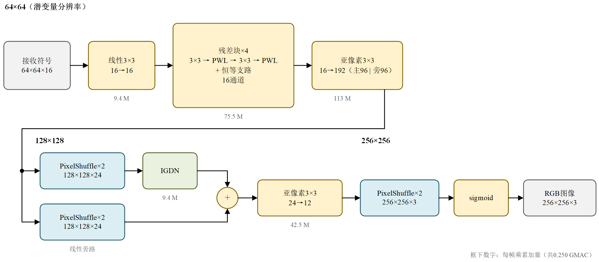
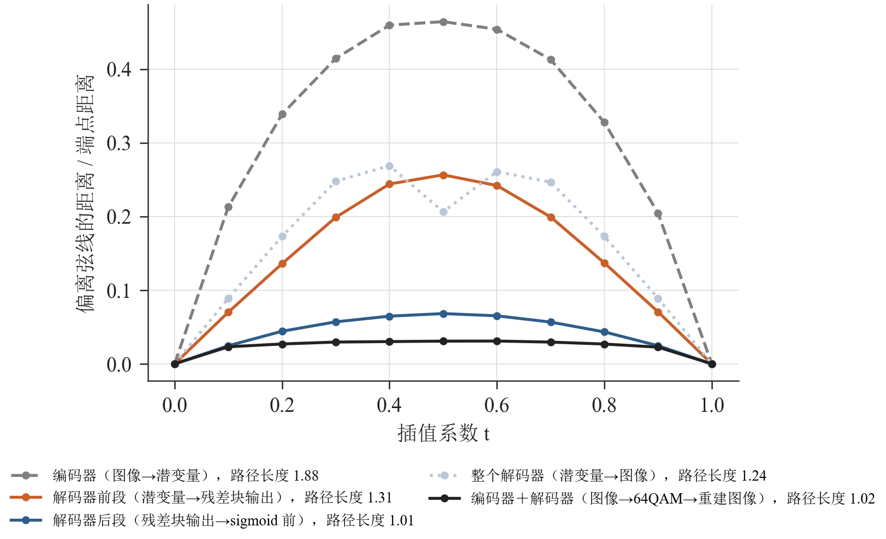
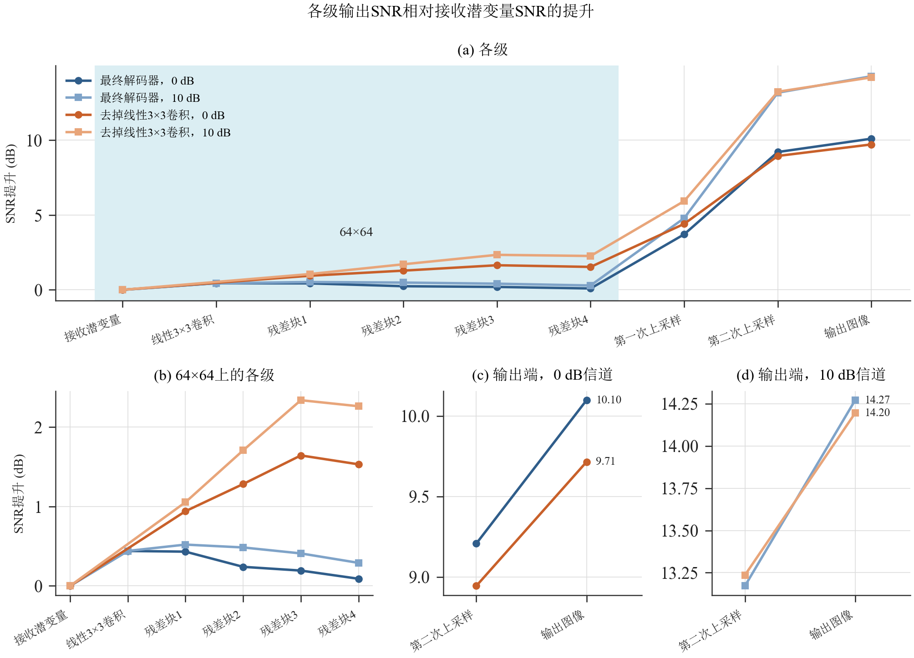
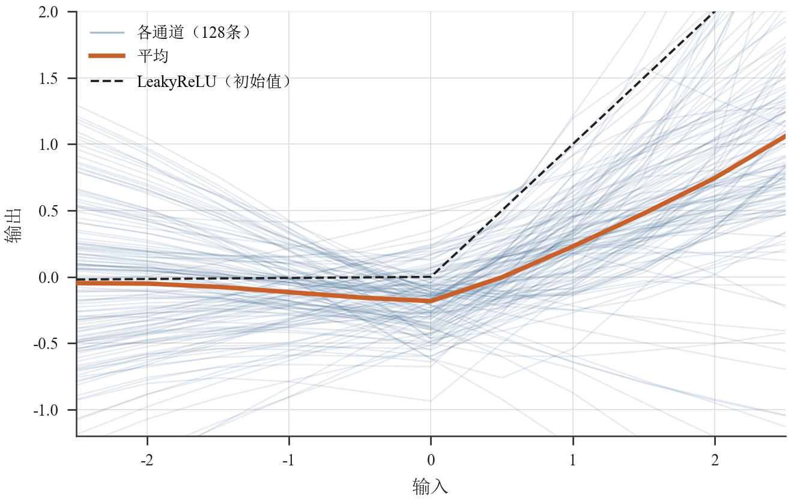
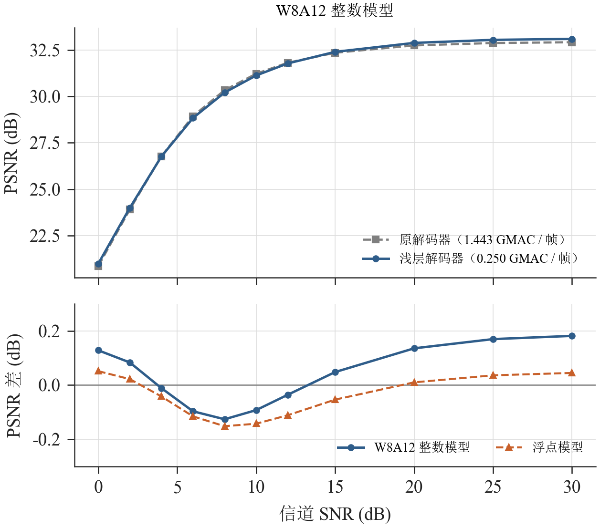

# 浅层解码器

本节描述替代原解码器的浅层解码器：结构、各部分的作用及依据、量化与硬件实现。编码器结构不变，与浅层解码器联合训练；解码器每帧乘累加量从1.443 GMAC降到0.250 GMAC，参数量从245,704降到53,332，W8A12整数模型与原解码器整数模型的PSNR差在0.15 dB以内。

## 1. 结构

图1　浅层解码器结构。框下数字为每帧乘累加量。

表1　各部分的分辨率与计算量

| 分辨率 | 模块 | 每帧乘累加量 |
|---|---|---|
| 64×64×16 | 线性3×3卷积（16→16，无激活） | 9.4 M |
| 64×64×16 | 4个残差块：3×3卷积 → PWL → 3×3卷积 → PWL，加恒等支路 | 75.5 M |
| 64×64 → 128×128 | 亚像素3×3卷积（16→192，主路与旁路各96通道）+ PixelShuffle；主路接IGDN，旁路线性，两路相加 | 113 M + 9.4 M |
| 128×128 → 256×256 | 亚像素3×3卷积（24→12）+ PixelShuffle，sigmoid输出RGB | 42.5 M |
| 合计 | | 250 M |

亚像素卷积是k×k卷积输出s²倍通道后接PixelShuffle，与步长为s的转置卷积等价，可以直接映射到现有的卷积引擎和`axis_pixel_shuffle`。PWL为每通道独立的可学习分段线性激活：9个折点均匀分布在[−2, 2]，共10段，初始化为LeakyReLU。

## 2. 设计依据

### 2.1 非线性集中在64×64，上采样部分接近线性

64QAM星座约束要求编码器输出的符号均匀使用64个星座点、平均功率为1，编码器因此是强非线性的映射。解码器要先把这种弯曲反解掉，再把特征展开成图像。用直线插值检验各部分的线性程度：在两幅图像（或两组特征）之间取x(t) = (1 − t)x₀ + t·x₁，比较输出沿t的路径与两端连线（弦）的偏离。DIV2K验证集100对图像、无噪声的结果见图2与表2。

图2　沿直线插值时输出偏离弦线的距离（相对端点距离，100对图像的中位数）。

表2　各部分沿直线插值的线性程度（中位数；完全线性时偏离为0、路径长度为1）

| 部分 | 最大偏离 / 端点距离 | 路径长度 / 端点距离 |
|---|---|---|
| 编码器：图像 → 潜变量 | 0.474 | 1.88 |
| 解码器前段：潜变量 → 第4个残差块输出 | 0.261 | 1.31 |
| 解码器后段：第4个残差块输出 → sigmoid前 | 0.068 | 1.01 |
| 解码器后段：第4个残差块输出 → 图像 | 0.097 | 1.02 |
| 整个解码器：潜变量 → 图像 | 0.297 | 1.24 |
| 编码器与解码器串联：图像 → 64QAM → 重建图像 | 0.032 | 1.02 |

编码器把图像空间的直线映射成明显弯曲的路径，而编码器与解码器串联后，重建图像沿t的路径又几乎是直线（不经过64QAM判决时为0.025与1.005），即编码器的非线性在解码器中被反解。解码器内部，前段的弯曲程度与整个解码器相当，后段在sigmoid之前几乎是直线：反解的工作由64×64上的线性3×3和残差块完成，两次上采样只做近似线性的插值与展开。因此非线性处理全部放在64×64上，这里每层卷积的计算量只有128×128的1/4、256×256的1/16；全分辨率上不设非线性层。

### 2.2 噪声抑制在上采样卷积中完成

同一组编码符号分别以无噪和加噪（AWGN）两种形式送入解码器，在每一级比较无噪输出（去掉各通道均值）的功率与噪声引起的偏差（有噪输出减无噪输出）的功率，见图3。

图3　各级输出的信号与噪声偏差之比，相对接收潜变量（DIV2K验证集100张）。

64×64上各级的比值与输入基本相同（变化在±0.3 dB以内），两次上采样后分别提高约4.5 dB和13 dB（10 dB信道）。上采样卷积的每个输出由3×3×C个输入加权组合而成，把噪声中不属于图像结构的分量投影掉；这也是浅层解码器在低信噪比下仍接近原解码器的原因（图5）。

### 2.3 可学习分段线性激活

残差块中的8个激活学到的曲线见图4。多数通道在0附近有一个下凹的拐点，两侧斜率不同，63 %的通道左侧（输入−2～−0.5）斜率为负，右侧（0.5～2）斜率中位数0.46。LeakyReLU左侧斜率只有1/128，表示不了这类形状。

图4　残差块中8个PWL激活的曲线（每图16个通道）。虚线为初始的LeakyReLU，阴影为10 dB信道下该激活输入的1 %～99 %分位范围。

PWL在硬件上是每通道一张小表加一次乘法，不需要DSP；按"折点纵坐标＋斜率"的形式定点实现时没有可测的量化损失（第3节）。

### 2.4 消融

表3　消融结果（DIV2K验证集PSNR，dB；每组与对照的训练条件相同）

| 改动 | 4 dB | 10 dB |
|---|---|---|
| 64×64上的4个残差块（对照：只有两次亚像素上采样，0.165 GMAC） | +0.64 | +0.68 |
| 残差块激活由LeakyReLU换成PWL（计算量不变） | +0.20 | +0.26 |
| 入口加线性3×3（+0.009 GMAC） | +0.19 | +0.04 |
| 128×128上再加一个瓶颈残差块（+0.030 GMAC） | +0.06 | −0.03 |
| 编码器与解码器联合训练（对照：冻结原编码器，以无噪声输入训练解码器） | +1.83 | +1.11 |

前三项保留在最终结构中；128×128上的瓶颈块没有收益，不采用。联合训练是浅层解码器能接近原解码器的前提：原编码器的码字是与深层解码器配套训练的，联合训练后编码器把码字调整成浅层解码器容易解读的形式。训练中保留星座分布的KL正则，联合训练后的编码器星座熵为6.00 bit、平均功率1.00，物理层（包括PAPR）不受影响。

## 3. 训练与量化

训练分三步：冻结原编码器、无噪声输入训练解码器300轮；编码器与解码器在10 dB AWGN下联合训练约1400轮（解码器学习率3×10⁻⁴，编码器1×10⁻⁴，验证PSNR 30轮不提高时减半，KL权重0.05）；最后200轮做8位权重的量化感知训练：前向时卷积权重按部署规则（每输出通道一个缩放）量化为8位，梯度加到浮点权重上。

整数模型沿用部署版的W8A12规则（权重8位、激活12位，逐通道重定标），编码器直接使用部署版的整数实现。PWL的12位输入定标取为2的幂次，使折点落在整数上、间距为2的幂次：

$$
s=\mathrm{clamp}\!\left(\left\lfloor\frac{x-T_0}{2^{L}}\right\rfloor+1,\,0,\,9\right),\quad k=\max(s-1,0),\quad
\mathrm{acc}=Y_c[k]+S_c[s]\,(x-T_0-k\,2^{L})
$$

其中$T_0$为第一个折点，$Y_c[k]$为通道c第k个折点的纵坐标（累加器尺度），$S_c[s]$为第s段的斜率（8位，每通道一个缩放），之后接与卷积相同的重定标。内部各段的偏移$x-T_0-k\,2^{L}$不超过一个段宽，斜率的量化误差不随|x|增大；折点处天然连续。

表4　W8A12整数模型的PSNR（dB，同一组噪声）

| 测试集 | 信道SNR | 浅层解码器 | 原解码器 | 差 |
|---|---|---|---|---|
| DIV2K验证集 | 10 dB | 31.13 | 31.22 | −0.09 |
| Kodak | 10 dB | 32.58 | 32.59 | −0.01 |
| DIV2K验证集 | 4 dB | 26.77 | 26.78 | −0.01 |
| Kodak | 4 dB | 28.17 | 28.32 | −0.15 |

在0～30 dB范围内，浅层解码器整数模型与浮点模型相差−0.01～+0.10 dB，原解码器整数模型比浮点模型低0～0.10 dB，信噪比越高损失越大。两种解码器的整数模型对比见图5：4～12 dB浅层解码器低0.01～0.13 dB，15 dB以上和2 dB以下高0.05～0.18 dB。

图5　PSNR随信道SNR的变化（DIV2K验证集100张，AWGN，两种解码器使用同一组噪声）。上：W8A12整数模型；下：浅层解码器减原解码器的PSNR差，实线为整数模型，虚线为浮点模型。

## 4. 硬件实现

浅层解码器全部由现有的参数化模块库搭成，只新增一个模块`axis_pwl`。顶层由脚本按导出的网络描述例化、传参和连线，与原解码器相同。

- 并行度：按与原解码器相同的规则（每层取满足30 fps的最小并行度P）规划，11个卷积引擎共48条乘累加通路，原解码器为53个引擎、296条。最忙的是第一次上采样的合并引擎（16→192，P = 18），读取窗口占帧时间的78 %。
- `axis_pwl`：按第3节的公式逐元素计算。段号由减法、算术右移和钳位得到；段内偏移乘斜率、重定标乘法都用基4串行LUT乘法器，不占DSP，约21个时钟周期处理一个元素。64×64×16的张量在30 fps下每个元素有约127个周期可用，满足要求。
- PixelShuffle之后的行FIFO：PixelShuffle处理完一行输入后要把缓存的子行整行输出，下游IGDN每个元素约需13个周期，若直接相连，合并引擎每行要停顿约4万周期。主路PixelShuffle与IGDN之间加一个容纳一行输出（3,072个元素）的FIFO后，该段的帧周期由876万降到649万个时钟周期，由合并引擎的读取时间决定。
- 验证：整个解码器（接收符号 → RGB输出）在xsim中连续2帧与整数参考模型逐比特一致，输入有效率90 %、输出就绪率80 %随机反压。帧周期见表5。

表5　解码器RTL仿真的帧周期（250 MHz）

| 解码器 | 帧周期（时钟周期） | 时间 |
|---|---|---|
| 原解码器 | 6,521,051 | 26.1 ms |
| 浅层解码器 | 6,494,147 | 26.0 ms |

## 5. 文件

- 训练与评估：`src/model/train_shallow_dec.py`（结构选项`--subpixel --k1 3 --n 24 --k2 3 --pre 4 --pre-act pwl --pre-lin 1`，联合训练`--joint`，续训`--resume-joint`，量化感知训练`--qat-wbits 8`）。
- 整数模型与导出：`src/model/quant_shallow.py`、`src/model/export_shallow.py`，导出在`data/model_shallow/`（含最终检查点）。
- RTL：`src/hw/rx/rtl/network/rtl/axis_pwl.sv`；顶层由`src/network/gen_rtl_top.py`生成（`--export data/model_shallow`）。仿真：`sim/network/run_top_sim.ps1 -First rx_in -Last output -Export data\model_shallow -GenDir src\network\gen_shallow`。
- 本节的图与数据：`src/model/shallow_analysis/report_figs.py`（图2～图5）、`interp_stages.py`（表2）、`denoise_stages.py`（图3）、`report/figures/visio/shallow_decoder.ps1`（图1）。消融的完整记录见`report/notes/shallow_decoder_experiments.md`。
