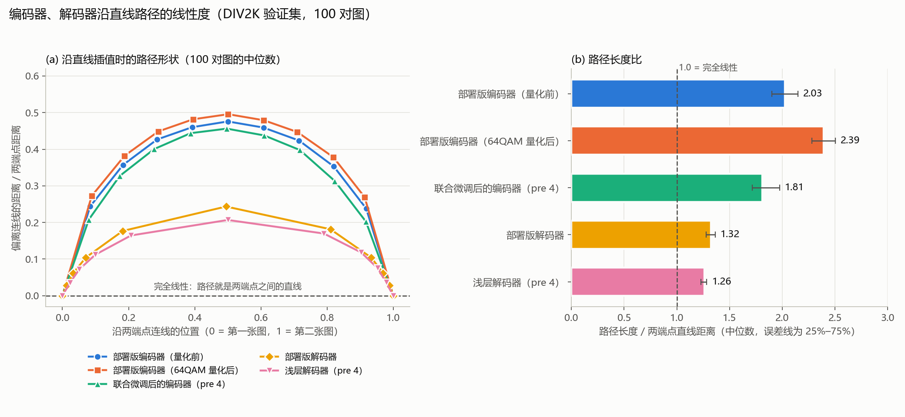
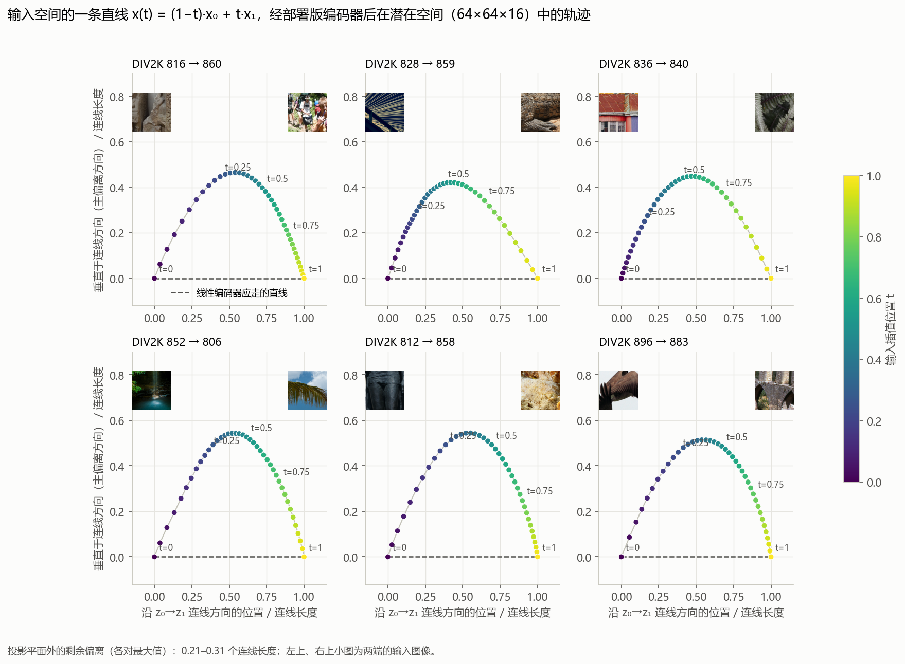
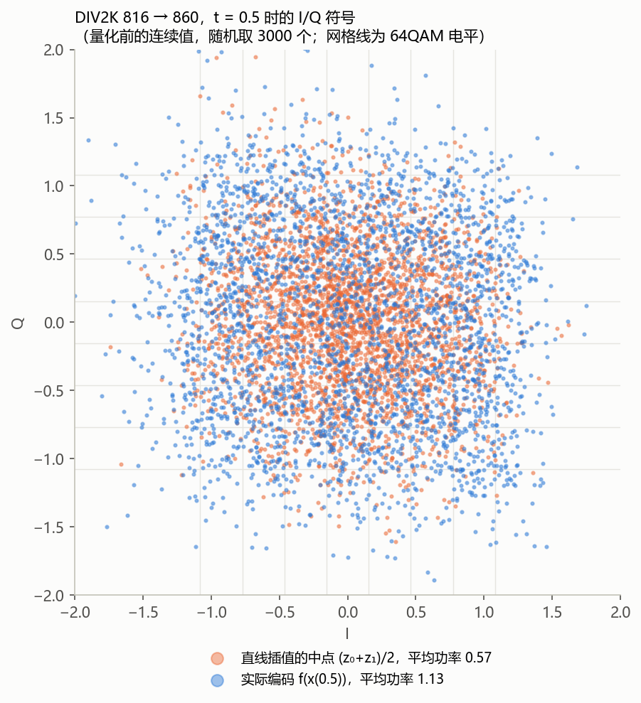
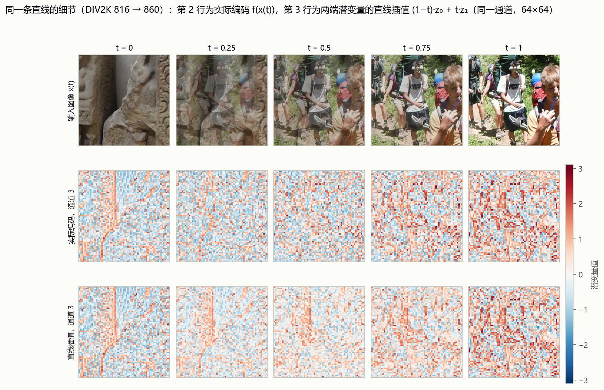
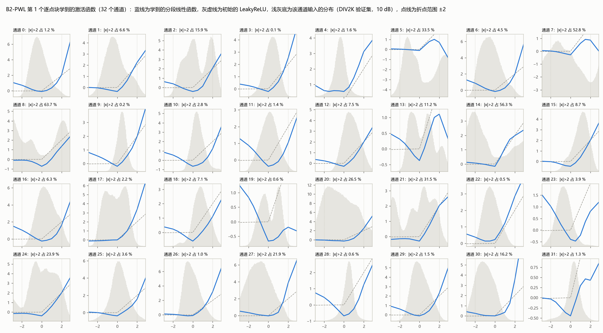
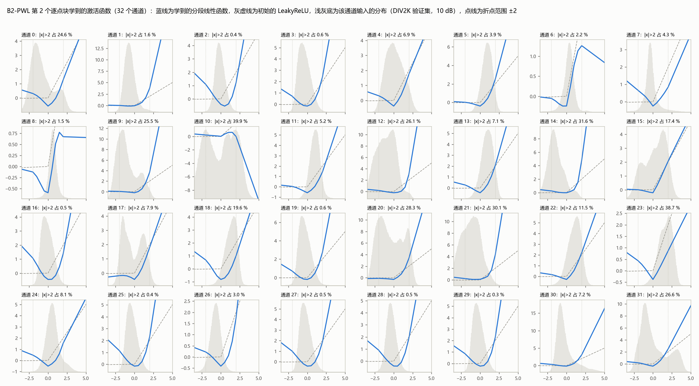
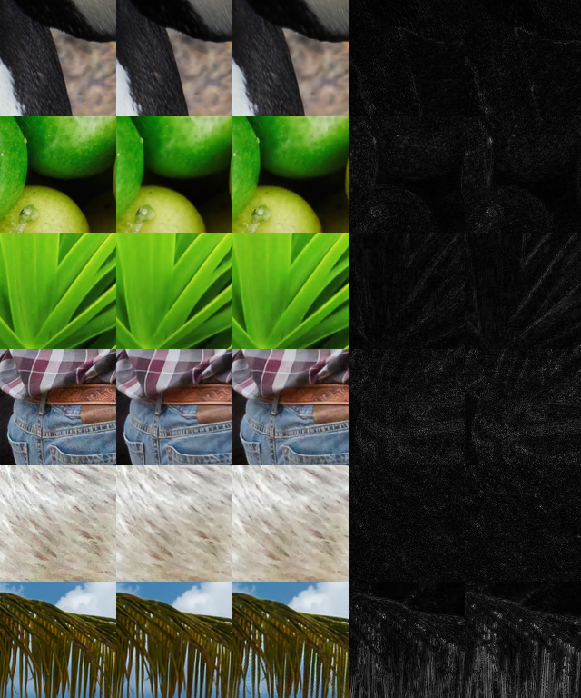

# DeepJSCC-Q 浅层解码器探索记录（2026-10-16 ～ 10-18）

分支 `exp/network-arch`，只在 PC 上训练和评估，未改动 RTL 与板上部署。

结论先行：最终候选为"64×64 上 1 个线性 3×3 + 4 个 PWL 残差块 + 两次子像素上采样"（0.250 GMAC/帧，约部署版 1/6），经长训练与 8 位权重量化感知微调后，W8A12 整数模型与部署版整数模型相比：DIV2K 10 dB −0.09 dB、Kodak 10 dB −0.01 dB、DIV2K 4 dB −0.01 dB、Kodak 4 dB −0.15 dB（第 6 节）。

## 1. 问题与出发点

Yang、Mandt 在 ICCV 2023 的 *Computationally-Efficient Neural Image Compression with Shallow Decoders* 中，把图像压缩的深层合成变换换成"一层大核转置卷积 + iGDN + 一层小核转置卷积"的两层结构（k1=13、s1=8、N=12，k2=5、s2=2），合成变换的计算量降到约 5.3 KMAC/像素，再用更强的编码器（ELIC 分析变换）和逐图迭代编码（SGA）补回性能。其依据是：压缩模型的潜在空间近似"平坦"，潜变量之间的直线插值解码后也接近图像空间的直线。

本记录回答：这一思路能否用于 DeepJSCC-Q 的解码端，即在保持编码器结构、64QAM 星座约束与物理层不变的前提下，把 RX 的解码器做得更轻。部署版解码器每帧 1.443 GMAC（约 22 KMAC/像素）。

## 2. 实验设置

- 编码器：部署版检查点（`data/model/checkpoint/best.pt`，第 1186 轮），结构不变。
- 信道：编码器输出硬判决到单位功率 64QAM，加 AWGN；解码器输入带噪的连续 I/Q。
- 数据：DIV2K 训练集 800 张 + Flickr2K 2650 张，随机裁 256×256；验证为 DIV2K 验证集 100 张中心裁剪，另测 Kodak 24 张原分辨率。
- 每种结构两个阶段（`src/model/train_shallow_dec.py`）：
  1. 冻结部署版编码器，无噪声输入训练浅层解码器 300 轮（Adam，学习率 1e-3，验证集 PSNR 不升 10 轮减半）；
  2. 以第 1 步解码器为初值，编码器从部署版权重开始，在 10 dB AWGN 下联合微调 300 轮：解码器学习率 3e-4，编码器 1e-4，星座 KL 正则权重 0.05、σ_q 固定为 100（与部署版训练末期一致）。
- 评估：DIV2K 验证集在 0–30 dB 与无噪声下逐点对比部署版（同一组噪声）；Kodak 在 5、10、20 dB 与无噪声下对比；同时报告联合微调后编码器的发射功率与星座熵。
- 计算量按每帧 256×256 统计卷积与 GDN 的乘加，用 forward hook 计数（部署版按此口径为 1.443 GMAC，含 GDN；报告中的名义卷积工作量 1.417 GMAC 不含 GDN）。
- 上采样一律用子像素卷积（k×k 卷积输出 s² 倍通道 + PixelShuffle），可直接映射到现有 RTL 的卷积引擎与 `axis_pixel_shuffle`；论文的转置卷积只在复现时使用。

## 3. 结构定义

| 名称 | 结构（64×64×16 潜变量 → 256×256×3） | GMAC/帧 |
|---|---|---|
| 论文原样 tc_k7 | 转置卷积 k1=7、s1=2、N=24 → iGDN，并联线性残差支路 → 转置卷积 k2=5、s2=2 → sigmoid | 0.193 |
| sp_k7 | 同上，两次上采样换成子像素卷积，首层 7×7 | 0.668 |
| B0 | 子像素 3×3 上采样（16→96，PS2 → 24 通道 → iGDN，并联线性残差支路）→ 子像素 3×3（24→12，PS2）→ sigmoid | 0.165 |
| B1 | B0 + 潜变量输入端 iGDN（16 通道） | 0.166 |
| B2 | B0 + 第一次上采样后（128×128，24 通道）2 个逐点块：1×1 24→32 → 激活 → 1×1 32→24，残差 | 0.215 |
| B2-PWL / B2-gate | B2 的激活换成可学习分段线性 / 门控 x·sigmoid(a·x+b) | 0.215 |
| pre 2 / pre 4 | B0 前在 64×64 上加 2 / 4 个残差块（3×3→LeakyReLU→3×3→LeakyReLU，加输入；16 通道） | 0.203 / 0.241 |
| pre 4 + mid | pre 4 + 第一次上采样后一层残差 3×3（24 通道） | 0.326 |
| C | pre 4 + 全分辨率尾部：最后一层输出 256×256×6 → LeakyReLU → 3×3 卷积 6→3 | 0.294 |
| A | pre 4，首层（两条支路）换成 7×7 | 0.744 |
| 加宽 pre 2 | pre 2 的残差块加宽到 24 通道（前接 3×3 16→24） | 0.321 |
| B2-PWL4 / B2-swl | B2-PWL 折点范围 ±4 / 激活为 a·x + b·x·sigmoid(c·x + d) | 0.215 |
| B2-PWL + 线性 3×3 | B2-PWL 前在 64×64 上加一个线性 3×3（16→16，无激活） | 0.225 |
| G1 / G2 | 3 个线性 3×3 + 2 个 PWL 逐点块 / 1 个线性 3×3 + 2 个 SwiGLU 块（x + W3[(W1x)·SiLU(W2x)]） | 0.244 / 0.250 |
| pre 4-PWL | pre 4 的激活全部换成 PWL | 0.241 |
| pre 4-PWL + 瓶颈块 | pre 4-PWL + 128×128 上一个瓶颈残差块（1×1 24→12 → PWL → 3×3 → PWL → 1×1 12→24） | 0.271 |
| L（最终候选） | pre 4-PWL 前加一个 64×64 线性 3×3（`--pre-lin 1`） | 0.250 |

LeakyReLU 负半轴斜率均为 1/128（与部署版相同）。

## 4. 结果

### 4.1 联合微调后（主结果）

DIV2K 验证集 PSNR（dB）；Kodak 为 24 张合并 MSE 的 PSNR。

| 结构 | GMAC/帧 | 4 dB | 10 dB | 20 dB | 无噪声 | Kodak 10 dB | 10 dB 与部署版差 |
|---|---|---|---|---|---|---|---|
| 部署版 | 1.443 | 26.72 | 31.27 | 32.84 | 33.03 | 32.65 | 0 |
| B0 | 0.165 | 25.61 | 29.68 | 31.50 | 31.74 | 30.89 | −1.59 |
| B1 | 0.166 | 25.58 | 29.65 | 31.43 | 31.66 | 30.90 | −1.62 |
| B2 | 0.215 | 25.77 | 30.11 | 31.81 | 32.03 | 31.43 | −1.17 |
| B2-PWL | 0.215 | 25.87 | 30.26 | 32.09 | 32.34 | 31.56 | −1.01 |
| B2-gate | 0.215 | 25.90 | 30.15 | 31.97 | 32.22 | 31.44 | −1.12 |
| pre 2 | 0.203 | 26.22 | 30.21 | 31.84 | 32.06 | 31.59 | −1.06 |
| pre 4 | 0.241 | 26.25 | 30.36 | 31.97 | 32.19 | 31.77 | −0.91 |
| C | 0.294 | 26.27 | 30.41 | 32.01 | 32.23 | 31.80 | −0.86 |
| A | 0.744 | 26.47 | 30.54 | 32.16 | 32.37 | 31.90 | −0.73 |
| B2-PWL4 | 0.215 | 25.94 | 30.24 | 32.05 | 32.30 | 31.57 | −1.03 |
| B2-swl | 0.215 | 25.84 | 30.26 | 32.05 | 32.29 | 31.55 | −1.01 |
| B2-PWL + 线性 3×3 | 0.225 | 26.15 | 30.40 | 32.10 | 32.32 | 31.80 | −0.87 |
| G1 | 0.244 | 26.29 | 30.35 | 32.08 | 32.31 | 31.81 | −0.92 |
| G2 | 0.250 | 26.06 | 30.36 | 32.09 | 32.33 | 31.75 | −0.91 |
| pre 4-PWL | 0.241 | 26.45 | 30.62 | 32.26 | 32.48 | 32.07 | −0.65 |
| pre 4-PWL + 瓶颈块 | 0.271 | 26.51 | 30.59 | 32.23 | 32.44 | 31.96 | −0.68 |

所有联合微调后的编码器发射功率为 0.995–1.000，星座熵均为 6.00 bit（64 个星座点均匀使用），物理层侧不需调整。

以上均为 300 轮联合微调。300 轮时各组都没有收敛（验证曲线在第 100 轮后大致平行上升），0.1 dB 量级的差别不可靠，0.3 dB 以上的差别可信。pre 4-PWL 与 B2-PWL 的比较说明 PWL 放在 64×64 残差块中同样有效（+0.26 dB，计算量不变）；128×128 瓶颈块在 pre 4-PWL 之上没有收益。E1–E3（pre 4 + 上采样后逐点块 / SwiGLU）未跑完即停止。

中途停止的两组：pre 4 + mid 联合微调到第 168 轮为 30.34 dB（与 pre 4 无差别）；加宽 pre 2 在冻结阶段第 150 轮落后 pre 4 约 0.2 dB 且计算量多三分之一，未做联合微调。

### 4.2 冻结编码器阶段（无噪声训练）

| 结构 | GMAC/帧 | 4 dB | 10 dB | 20 dB | 无噪声 |
|---|---|---|---|---|---|
| tc_k7（论文原样，10 dB 训练） | 0.193 | 22.19 | 25.11 | 25.98 | 26.07 |
| tc_k7（无噪声训练） | 0.193 | 20.87 | 24.48 | 25.93 | 26.10 |
| sp_k7 | 0.668 | 22.75 | 27.25 | 29.27 | 29.53 |
| B0 | 0.165 | 20.42 | 24.57 | 26.00 | 26.15 |
| B1 | 0.166 | 18.22 | 24.10 | 26.00 | 26.19 |
| B2 | 0.215 | 21.35 | 25.52 | 26.84 | 26.98 |
| B2-PWL | 0.215 | 21.41 | 25.68 | 27.04 | 27.19 |
| B2-gate | 0.215 | 21.62 | 25.65 | 26.97 | 27.12 |
| pre 2 | 0.203 | 23.84 | 28.69 | 30.57 | 30.80 |
| pre 4 | 0.241 | 24.42 | 29.25 | 31.13 | 31.38 |
| pre 4 + mid | 0.326 | 24.02 | 29.33 | 31.36 | 31.62 |
| C | 0.294 | 24.15 | 29.29 | 31.23 | 31.49 |
| A | 0.744 | 24.37 | 29.44 | 31.44 | 31.71 |

这一阶段的结构排序与联合微调后差别很大（B0 与 pre 4 冻结时差 5.2 dB，联合微调后只差 0.68 dB），不能用来比较结构，原因见 5.1。

### 4.3 长训练、线性 3×3 与量化

300 轮的差距主要是训练长度：把联合微调延长到 800 轮、学习率减半前的等待从 10 轮改为 30 轮（其余不变），pre 4-PWL 的 10 dB 从 30.62 提高到 31.02。再从第 800 轮的最好检查点续训 600 轮（学习率接续，`--resume-joint`）得到 A 组。L 组为 pre 4-PWL 前加一个线性 3×3，同样先 800 轮、再续训 600 轮，最后做 200 轮 8 位权重的量化感知微调（`--qat-wbits 8`）。

浮点模型（DIV2K 验证集 PSNR，dB；训练脚本的评估）：

| 模型 | GMAC/帧 | 4 dB | 10 dB | 20 dB | 无噪声 | Kodak 10 dB |
|---|---|---|---|---|---|---|
| 部署版 | 1.443 | 26.72 | 31.27 | 32.84 | 33.03 | 32.65 |
| pre 4-PWL，300 轮 | 0.241 | 26.45 | 30.62 | 32.26 | 32.48 | 32.07 |
| pre 4-PWL，800 轮 | 0.241 | 26.50 | 31.02 | 32.77 | 33.01 | 32.47 |
| A：pre 4-PWL，800 + 600 轮 | 0.241 | 26.55 | 31.16 | 32.90 | 33.14 | 32.62 |
| L，800 轮 | 0.250 | 26.69 | 31.06 | 32.82 | 33.06 | 32.53 |
| L，800 + 600 轮 | 0.250 | 26.67 | 31.19 | 32.96 | 33.21 | 32.65 |
| L，+ 200 轮量化感知微调 | 0.250 | 26.67 | 31.13 | 32.85 | 33.08 | 32.60 |

- 训练长度：pre 4-PWL 从 300 轮到 1400 轮，10 dB 提高 0.54 dB，主要在中高信噪比；4 dB 只提高 0.10 dB。
- 线性 3×3：同为 800 轮，L 比 pre 4-PWL 在 4 dB 高 0.19 dB，其余信噪比持平或略高。低信噪比的差距是结构（噪声平均的感受野）问题，不是训练问题，与 5.5 一致。
- 联合微调后编码器的发射功率与星座熵不变（约 1.00、6.00 bit）。

W8A12 整数模型（`src/model/quant_shallow.py`：编码器按部署版整数模型 `int_ref.encode`，浅层解码器按同一套整数算子加 PWL；与部署版整数模型用同一组噪声）。下表为整数模型与部署版整数模型（DIV2K 31.22 / 26.78，Kodak 32.59 / 28.32）的差，单位 dB：

| 模型 | DIV2K 10 dB | Kodak 10 dB | DIV2K 4 dB | Kodak 4 dB | 10 dB 量化损失 |
|---|---|---|---|---|---|
| pre 4-PWL，800 轮 | −0.29 | −0.25 | −0.33 | −0.37 | 0.09 / 0.14 |
| A | −0.14 | −0.09 | −0.18 | −0.27 | 0.08 / 0.13 |
| L，800 轮 | −0.25 | −0.19 | −0.05 | −0.16 | 0.09 / 0.13 |
| L，800 + 600 轮 | −0.17 | −0.09 | −0.12 | −0.24 | 0.13 / 0.16 |
| L，+ 量化感知微调（最终候选） | −0.09 | −0.01 | −0.01 | −0.15 | 0.00 / 0.03 |

（前两行与第 3 行的 PWL 为"斜率 + 截距"形式，后两行为折点形式，见 5.8。量化损失为 DIV2K / Kodak 的浮点减整数；部署版为 0.05 / 0.06。）

### 4.4 量化损失的来源

L 续训后量化损失变大（10 dB 0.13–0.16 dB）。逐项排查（同一检查点）：

| 改动 | 10 dB 量化损失（DIV2K / Kodak） |
|---|---|
| 基线：W8A12，PWL 斜率 + 截距，8 位斜率 | 0.155 / 0.207 |
| PWL 改为折点形式（8 位斜率） | 0.134 / 0.163 |
| PWL 完全不量化（参考） | 0.146 / 0.189 |
| 激活定标余量 1.5 → 1.25 / 1.1 | 无变化（1.25 起开始出现个别饱和） |
| 卷积权重 8 → 10 位（诊断） | 0.028 |
| 8 位权重量化感知微调 200 轮 | 0.002 / 0.027 |

- 逐层看，续训前后各层整数张量相对浮点的信噪比几乎相同（多在 29–35 dB），PWL 输出最低（24–26 dB，斜率 + 截距形式）。定标余量 1.5 下所有层在 DIV2K 与 Kodak 上饱和数为 0。
- 剩余损失来自 8 位卷积权重：继续训练使网络对权重量化更敏感。量化感知微调（前向用每输出通道 8 位量化的权重，梯度加到浮点权重上，验证与选检查点也用量化权重）把损失降到部署版以下，浮点 PSNR 降约 0.05 dB，整数 PSNR 四项提高 0.08–0.12 dB。RTL 仍为 W8。

## 5. 分析

### 5.1 联合微调起决定作用

冻结的部署版编码器是与深层解码器配套训练的，浅层解码器读不懂它的码字；编码器一起训练后会把码字调整成浅层解码器容易解读的形式。最轻的 B0（只有两次子像素上采样，约为部署版计算量的 1/9）联合微调后在 10 dB 下只比部署版低 1.59 dB。此前冻结阶段得出的"64×64 残差块带来 5 dB"的结论，绝大部分其实是编码器不匹配造成的。

### 5.2 编码器才是强非线性的部分（星座约束所致）

沿两张图之间的直线 x(t)=(1−t)x₀+t·x₁ 插值，比较潜变量（或重建图）偏离直线的程度（100 对 DIV2K 图的中位数）：

| | 最大偏离 / 端点距离 | 路径长度 / 端点距离 |
|---|---|---|
| 部署版编码器（量化前） | 0.50 | 2.03 |
| 部署版编码器（64QAM 后） | 0.52 | 2.39 |
| 联合微调后的编码器（pre 4） | 0.47 | 1.81 |
| 部署版解码器 | 0.32 | 1.32 |
| 浅层解码器（pre 4） | 0.29 | 1.26 |





输入空间的直线在潜在空间里变成一条拱形曲线（偏离 0.42–0.55 个端点距离，投影平面外还有 0.21–0.31）。潜变量范数沿路径保持在端点的 0.99–1.00 倍；中间点等于两端潜变量的平均（最优缩放系数约 1）再加一个与之正交、大小相当的分量，把功率补回 1。t=0.5 时直接平均两端潜变量得到的符号挤在星座中央、平均功率 0.57，实际编码仍铺满整个 64QAM 网格、平均功率 1.13：





原因是星座约束：KL 正则要求 64 个点均匀使用、平均功率为 1，编码器无论输入什么（包括两图混合）都必须输出功率饱满、分布均匀的符号，不能输出两个码字的平均。这一约束不能放宽：去掉 KL 后符号会集中到少数星座点、子载波间相关性升高，OFDM 的 PAPR 会显著上升。因此论文"潜在空间平坦"的前提在 DeepJSCC-Q 上不成立，解码器需要一定的非线性去适配这种弯曲的映射；联合微调后编码器的路径变直了一些（2.03 → 1.81），这正是 5.1 中编码器适配解码器的体现。

### 5.3 非线性的位置：先线性平均，再非线性

接收到的潜变量 = 发送符号 + 独立高斯噪声。B1 在输入端直接加 iGDN（乘性归一化），在第一次线性平均之前就让噪声与信号耦合、噪声分布不再是高斯：冻结阶段 4 dB 下比 B0 低 2.2 dB，联合微调后与 B0 持平（被编码器和后续层补平），没有任何收益。B2 把同等便宜的非线性放在第一次上采样卷积之后（3×3 卷积已对噪声做了一次加权平均），各信噪比提升 0.3–0.4 dB，只多 0.05 GMAC。这与接收机"先匹配滤波、后判决"的原则一致。

### 5.4 激活函数：LeakyReLU 不够

B2 的结构与计算量不变，只换激活：可学习分段线性（PWL）比 LeakyReLU 再高 0.10–0.31 dB，无噪声与 20 dB 下超过 pre 4（0.241 GMAC），接近 A（0.744 GMAC）；门控激活在 4 dB 下略好、高信噪比下介于两者之间。

PWL 的实现：每个通道 f(x) = a·x + b + Σₖ cₖ·ReLU(x − tₖ)，9 个固定折点均匀分布在 [−2, 2]，每通道学 11 个参数，初始化为 LeakyReLU。推理时可写成每通道 10 段的 (斜率, 截距) 表，段号由 (x+2)/0.5 取整得到，每个元素一次查表加一次乘加。

学到的 64 条曲线大多是 Swish 形：在 0 附近平滑下凹到约 −0.3，右侧斜率明显大于左侧。按参数计算（中位数），左侧斜率（−2 到 −0.5）为 −0.24 / −0.30（两块），右侧（0.5 到 2）为 +1.25 / +1.44，右侧约为左侧绝对值的 4 倍；63/64 个通道左侧斜率为负。与标准 x·sigmoid(x) 的区别在于左侧：后者在 −2 到 −0.5 的平均斜率只有约 +0.03，趋于 0，而学到的曲线保持明显的负斜率。少数通道为先升后降的"鼓包"形。LeakyReLU 左侧斜率仅 1/128，表示不了这类形状；门控 x·sigmoid(a·x+b) 左侧只能趋于 0，这也解释了 B2-gate 不如 B2-PWL。约 12–13 % 的输入落在 ±2 以外（个别通道 30–64 %）；但把折点范围扩大到 ±4（B2-PWL4）联合微调后各信噪比相差不超过 0.07 dB，折点范围不是瓶颈。

形状的来源：
- 拐点平滑不是信道噪声造成的。无噪声训练阶段学到的拐点宽度（斜率变化 10 %–90 % 的区间）为 1.50，10 dB 联合微调后为 1.52，几乎相同；网络在无噪声时就主动把 LeakyReLU 的尖拐点拉宽并右移到约 +0.5。
- 在实际输入范围内用多项式拟合，一次、二次、三次的 R² 中位数分别为 0.53、0.944、0.988，二次项能解释大部分方差。但功能上并不只是二次：不重新训练、把各激活直接换成拟合的多项式，二次时 PSNR 降 3.2–3.7 dB，三次仍降 1.0–1.8 dB；在 0.5 %–99.5 % 输入范围之外保留学到的线性尾部，比多项式延伸到底好 0.5–1 dB。训练好的网络依赖高于二阶的成分和尾部形状，这与编码器多层 GDN 加注意力门控、需要较复杂的逆变换一致。是否能从头用二次类激活训练出相同性能，尚未验证。
- 参数化的 Swish 加线性项 f(x) = a·x + b·x·sigmoid(c·x + d)（每通道 4 个参数，B2-swl）联合微调后与 PWL 基本相同（10 dB 30.26，无噪声 32.29），硬件上可复用现有 sigmoid 单元，比 PWL 查表更易实现。





### 5.5 感受野与高、低信噪比的分工

- 4 dB 下 B2 系列（25.77–25.90）仍比 pre 系列（26.22–26.25）低约 0.35–0.45 dB；20 dB 与无噪声下 B2-PWL 已追平或超过 pre 4。低信噪比时需要在潜变量上平均更大范围的噪声（感受野），高信噪比时差距在细节合成（非线性）。
- 大卷积核（A：首层 7×7）在已有 pre 块的基础上各信噪比稳定多 0.15–0.2 dB，但计算量是 pre 4 的 3 倍。7×7 核的分析：非线性支路 86 % 的权重能量在中心 3×3，线性残差支路 34 % 在 3×3 以外（大范围线性插值）；按"16→r→96"做通道低秩时 r=8 只保留约 40 % 能量、直接替换掉 13 dB，不适合（96 个输出是 24 个特征 × 4 个子像素相位，本身不低秩）；空间上 7×1·1×7 的秩 1 近似可保留 73–86 % 能量，但需要非方形卷积核，现有 RTL 不支持。
- 在 128×128 或 256×256 上补非线性（pre 4 + mid、C）联合微调后几乎无收益；C 的全分辨率尾部只消除了最后一次 PixelShuffle 的 2×2 网格误差（1/2 周期/像素的误差尖峰 4.0 → 3.0），高频能量保留只从 0.740 到 0.745。

### 5.6 与部署版的差在哪里

以 pre 4 联合微调模型为例（DIV2K 验证集，同一噪声）：两者的误差都主要在高频（1/8 周期/像素以上约占 75–80 %）；浅层在各频段误差约为部署版的 1.2–1.35 倍，最低频段相当甚至略好。重建图在最高频段（>1/4 周期/像素）保留原图能量的比例：部署版 0.785、浅层 0.740（无噪声 0.759 / 0.689），梯度能量 0.816 / 0.779，即主要差在边缘与细纹理的锐度，不是噪点。另有 PixelShuffle 带来的 4 像素周期网格误差，比部署版略重，但只占几个频点，肉眼难以察觉。



（每行一张图的 128×128 局部，放大 2 倍；列依次为原图、部署版、浅层、部署版误差 ×4、浅层误差 ×4；无噪声。）

### 5.7 关于"去噪"的误判

最初推测浅层网络去噪能力不足、低信噪比会损失更多。实际相反：联合微调后各结构在 4 dB 下与部署版的差距（0.25–1.1 dB）都小于 10 dB 下的差距（0.7–1.6 dB）。原因：平缓下降来自编码映射的连续性，不依赖解码器深度；高斯噪声下逐符号去噪大部分靠多个符号的加权平均即可完成；浅层的短板是高信噪比下的细节合成，而低信噪比时这些细节本来就被噪声淹没。显式的 64QAM 软判决因此价值不大：无噪声时浅层仍差约 0.8 dB，软判决在无噪声下等于恒等映射。

### 5.8 PWL 的定点形式

PWL 的输入定标取为 2 的幂次（前一层卷积的输出定标向上取整），使 9 个折点落在整数上、间距为 2 的幂次，段号 = clamp(⌊(x − T₀)/Δ⌋ + 1, 0, 9) 只需移位与钳位。

- 斜率 + 截距：y = S[seg]·x + I[seg]。斜率的量化误差乘的是 x 本身，离原点越远误差越大；量化后折点处还有小跳变。
- 折点纵坐标 + 斜率（采用）：y = Y[k] + S[seg]·(x − T[k])，k 为该段左端折点（x < T₀ 时取 T₀）。内部各段的偏移不超过一个段宽，就是 x 的低位；折点处天然连续。每通道存 9 个折点纵坐标（累加器尺度）与 10 个 8 位斜率（每通道一个缩放），之后接与卷积相同的重定标。

8 位斜率的折点形式与 PWL 不量化的结果相差不到 0.03 dB（4.4），斜率无需加宽。

## 6. 结论

1. 解码器可以做得很轻：只有两次子像素上采样（0.165 GMAC，约部署版 1/9）、编码器联合微调后，10 dB 下比部署版低 1.6 dB；关键在编码器与解码器联合训练。
2. 便宜的非线性要放在第一次线性平均之后；在输入端加非线性无益。
3. 激活函数影响明显：可学习分段线性在不增加卷积计算量的情况下，使 0.215 GMAC 的 B2-PWL 在 10 dB 下只比部署版低 1.0 dB、无噪声下低 0.7 dB。
4. 低信噪比的剩余差距来自感受野，高信噪比的差距来自细节合成能力；64×64 上的残差块（pre）主要提供前者。
5. DeepJSCC-Q 编码器受星座约束（功率与均匀分布，不能放宽，否则 PAPR 上升）而强烈非线性，这是论文"浅层线性合成"不能直接搬用的根本原因。
6. 300 轮时与目标差的 0.15 dB 是训练长度问题：长训练使 10 dB 再提高约 0.5 dB；低信噪比的差距则靠一层线性 3×3（感受野）补上。
7. 最终候选 L（0.250 GMAC）经 8 位权重量化感知微调后，W8A12 整数模型与部署版整数模型的差在 0.01–0.15 dB 之间，达到"相差 0.5 dB 以内"的目标；量化损失低于部署版。PWL 用折点形式定点实现时没有可测的损失。

## 7. 局限

- 每种结构只跑一次、一个随机种子；0.1–0.2 dB 量级的差别与训练波动同量级，单轮验证 PSNR 的波动可达 0.3 dB。
- 只在 10 dB 下联合微调，未测其他训练信噪比；N=24、k=3 等超参数未系统扫描。
- L 与 A 的总训练轮数（约 1400 轮联合微调）比 300 轮的各组多得多，结构之间的比较以同轮数为准（4.1、4.3 中的同轮对比）。
- 联合微调改变了编码器权重：若部署，需重建两块板的比特流；尚未用 PHY 模型（含 PN 符号翻转）核对 OFDM 的 PAPR，只确认了星座熵与功率。
- 量化验证为 PC 上的整数模型；RTL、逐比特比对与上板验证尚未进行，PWL 需要新写一个 RTL 模块（5.8）。

## 8. 下一步（候选）

1. 导出：把 `export_fpga.py` 扩展到 L（编码器权重也随联合微调改变，需一起导出），生成参数、PWL 表、manifest 与逐比特比对数据。
2. RTL：新写 PWL 模块（折点形式，5.8），用现有模块库搭解码器顶层，重做存储规划与综合；编码器只换权重。
3. 上板前用 PHY 模型核对联合微调后编码器的 PAPR（含 PN 扰码）。

## 9. 文件与复现

- 训练与评估：`src/model/train_shallow_dec.py`（选项见文件头说明，`--eval-only` 对已有检查点做信噪比扫描）。
- 分析脚本：`src/model/shallow_analysis/`
  - `diff_analysis.py <out> <run>`：频段误差、高频能量、4×4 网格误差、局部对比图；
  - `interp_test.py`、`interp_scale.py`、`interp_plot.py`、`latent_path_viz.py`：直线插值实验与潜在空间可视化；
  - `kernel_analysis.py`：A 的 7×7 核分析（空间范围、通道低秩、可分离性、截断测试）；
  - `pwl_plot.py`：PWL 曲线与输入分布；
  - `make_summary.py <runs>`：汇总所有联合微调结果，`summary_20261017.md`、`summary_20261018.md` 为 300 轮各组的汇总（长训练与量化见 4.3）；
  - `quant_layer_err.py --ckpt ...`：浅层解码器逐层的整数张量信噪比与饱和率。
- W8A12 检查：`src/model/quant_shallow.py --ckpt <run>/best.pt`（`--pwl-form knot|icpt|float`、`--pwl-wbits`、`--wbits`、`--headroom`）。
- 最终候选的训练链（`runs_shallow/queue18.sh` → `queue19.sh` → `queue20.sh`）：300 轮无噪声 → 800 轮联合微调（`--plateau-patience 30`）→ `--resume-joint` 续训 600 轮（学习率 1.5e-4 / 5e-5）→ `--qat-wbits 8` 200 轮（学习率 7.5e-5 / 2.5e-5，`--plateau-patience 20`）；结构选项 `--subpixel --k1 3 --n 24 --k2 3 --pre 4 --pre-act pwl --pre-lin 1`。
- 运行结果（检查点、日志、`sweep.json`）在 `D:\ClaudePrj\DeepJSCC-Q\runs_shallow\`，未入库；Python 环境与数据路径见脚本中的默认参数。
- 示例（B2-PWL，两阶段）：

```
python train_shallow_dec.py --cache <cache> --kodak <Kodak> --output-dir runs/clean_b2pwl --epochs 300 --snr-db inf --subpixel --k1 3 --n 24 --k2 3 --pw-mid 2 --pw-act pwl
python train_shallow_dec.py --cache <cache> --kodak <Kodak> --output-dir runs/joint_b2pwl --epochs 300 --snr-db 10 --subpixel --k1 3 --n 24 --k2 3 --pw-mid 2 --pw-act pwl --joint --enc-lr 1e-4 --kl-lambda 0.05 --lr 3e-4 --init-decoder runs/clean_b2pwl/best.pt
```
